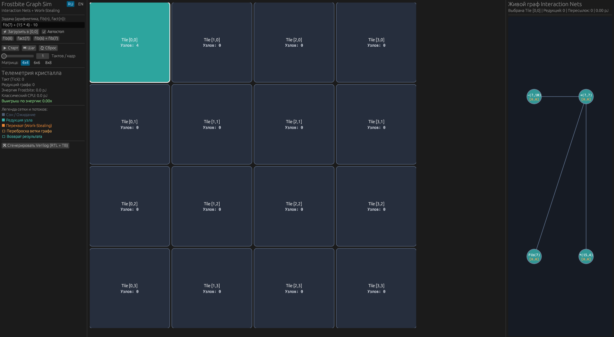
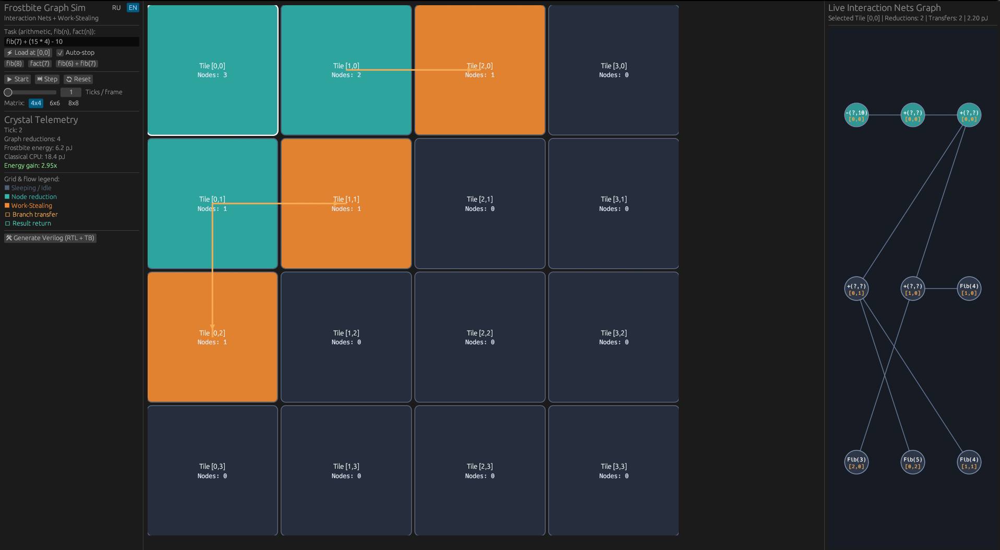

# Frostbite Graph Core Simulator

**[English](#english) | [Русский](#русский)**

---

## English

An interactive native simulator for graph-based processor cores built on the **Interaction Nets** computation model, featuring decentralized load balancing (**Work-Stealing**) and synthesizable **SystemVerilog (RTL)** export.

Inspired by graph processor architectures without a centralized instruction pipeline, this tool lets you visually observe how computation waves spread across a grid of independent processing tiles (`Tiles`).

### Key Features
* **True Interaction Nets Execution:** Built-in expression parser transforms arithmetic expressions and recursive functions (`fib(n)`, `fact(n)`) into a network of interacting agent nodes without a central scheduler.
* **Decentralized Work-Stealing:** Idle tiles automatically steal unexpanded graph branches from overloaded neighbors and route computed results back to parent nodes.
* **Real-Time Visualization (Rust + egui):**
  * Configurable tile matrix (`4×4`, `6×6`, `8×8`) showing tile states (*Sleeping*, *Computing*, *Stealing*) and live data-flow arrows.
  * Live Interaction Nets graph view mapping active agent nodes to their host tile coordinates, with single-step tick debugging.
  * Energy efficiency telemetry comparing the graph core against a classical sequential CPU.
* **Hardware Bridge (SystemVerilog Export):** One-click generation of synthesizable tile grid RTL (`frostbite_grid.sv`) and a ready-to-run testbench (`frostbite_tb.sv`) for `Icarus Verilog`, `Verilator`, or FPGA synthesis.

### Requirements
* **Rust** (edition 2021+)
* **Icarus Verilog** (`iverilog`) — optional, for running generated SystemVerilog simulations

### Quick Start
```bash
git clone https://github.com/1mesles1/frostbite-sim.git
cd frostbite-sim
cargo run --release
```

### Installation (Arch Linux)
```bash
git clone https://github.com/1mesles1/frostbite-sim.git
cd frostbite-sim
makepkg -si
```

### Testing Generated SystemVerilog
1. Click **"Generate Verilog (RTL + TB)"** inside the simulator — files are saved to `./verilog_out/`.
2. Run gate-level simulation:
```bash
cd verilog_out
iverilog -g2012 -o sim.out frostbite_grid.sv frostbite_tb.sv
vvp sim.out
```

---
## Screenshots
[](screenshots/01.png) [](screenshots/02.png)

## Русский

Интерактивный нативный симулятор графовых процессорных ядер на базе модели **Interaction Nets** с децентрализованной балансировкой нагрузки (**Work-Stealing**) и экспортом в синтезируемый **SystemVerilog (RTL)**.

### Основные возможности
* **Реальные вычисления на Interaction Nets:** встроенный парсер преобразует арифметические выражения и рекурсивные функции (`fib(n)`, `fact(n)`) в сеть взаимодействующих узлов-агентов без центрального планировщика.
* **Децентрализованный Work-Stealing:** свободные плитки автоматически перехватывают невычисленные ветки графа у перегруженных соседей и возвращают готовые значения родительским узлам.
* **Визуализация в реальном времени (Rust + egui):**
  * Матрица плиток (`4×4`, `6×6`, `8×8`) с индикацией состояний (*Сон*, *Редукция*, *Перехват*) и стрелками потоков данных.
  * Живой граф активных узлов с привязкой к координатам плиток и пошаговой отладкой.
  * Телеметрия энергопотребления в сравнении с классическим последовательным CPU.
* **Экспорт в SystemVerilog:** генерация синтезируемого RTL-кода сетки плиток (`frostbite_grid.sv`) и тестбенча (`frostbite_tb.sv`) для `Icarus Verilog`, `Verilator` и FPGA.

### Требования
* **Rust** (edition 2021+)
* **Icarus Verilog** (`iverilog`) — опционально, для запуска симуляции сгенерированного SystemVerilog

### Быстрый старт
```bash
git clone https://github.com/1mesles1/frostbite-sim.git
cd frostbite-sim
cargo run --release
```

### Установка (Arch Linux)
```bash
git clone https://github.com/1mesles1/frostbite-sim.git
cd frostbite-sim
makepkg -si
```

### Проверка сгенерированного SystemVerilog
1. Нажмите **«Сгенерировать Verilog (RTL + TB)»** внутри симулятора — файлы сохранятся в директорию `./verilog_out/`.
2. Запустите симуляцию на уровне логических вентилей:
```bash
cd verilog_out
iverilog -g2012 -o sim.out frostbite_grid.sv frostbite_tb.sv
vvp sim.out
```

## License / Лицензия
MIT License — see [LICENSE](LICENSE) for details.

